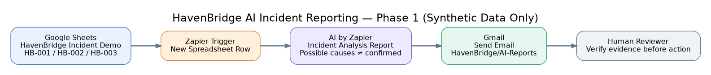
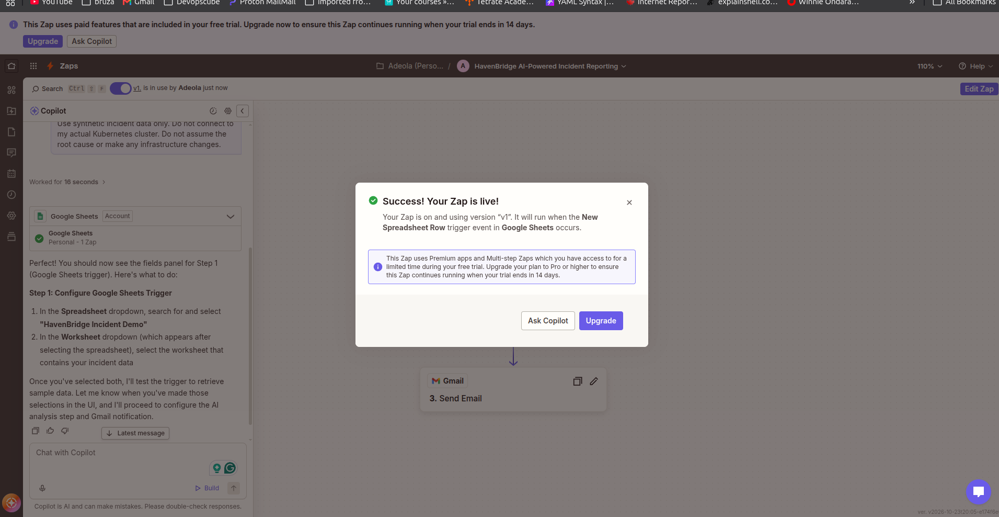
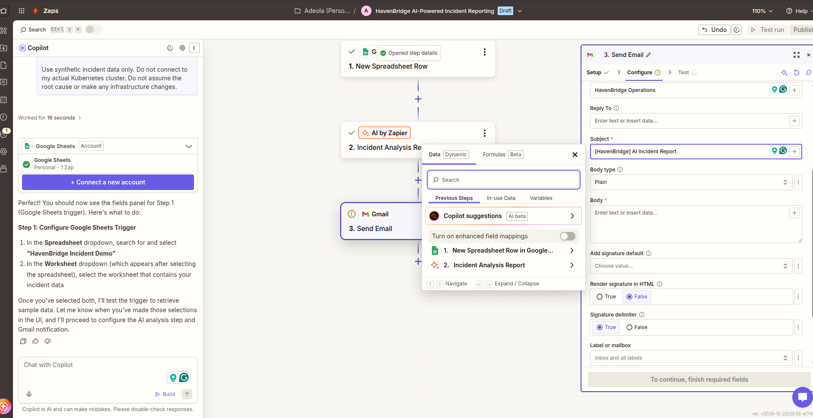
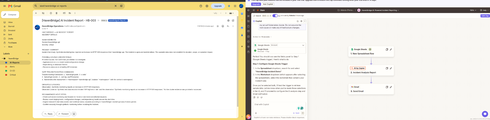

# HavenBridge — AI-Powered Incident Reporting

**Phase 1: Zapier Proof of Concept**
**Status:** Published and tested with synthetic incidents
**Evidence date:** October 24, 2026
**Scope:** Demonstration only; no live Kubernetes access

## 1. Overview

This proof of concept demonstrates an event-driven AI incident-reporting workflow. A new synthetic incident row in Google Sheets triggers Zapier. AI by Zapier creates a structured incident analysis, and Gmail sends the report to the configured test mailbox. The report is for human review and does not perform remediation.

## 2. Workflow

1. **Source:** A row is added to the Google Sheets workbook `HavenBridge Incident Demo`.
2. **Trigger:** Zapier's `New Spreadsheet Row` detects the new row.
3. **Analysis:** `AI by Zapier — Incident Analysis Report` receives the incident fields and produces a structured report.
4. **Delivery:** `Gmail — Send Email` delivers the report to the configured test mailbox.
5. **Review:** A human checks the observations, unconfirmed causes, commands, and recommendations before taking any action.

The incident source uses columns: `Incident_ID`, `Service`, `Severity`, `Alert`, `Observation`, and `Status`.

## 3. Demonstration incidents

| ID | Service | Severity | Synthetic scenario | Status in sample |
| --- | --- | --- | --- | --- |
| HB-001 | havenbridge-api | Critical | API unavailable; HTTP health check failed | Open |
| HB-002 | havenbridge-postgres | Warning | PostgreSQL connectivity failure affecting application requests | Open |
| HB-003 | havenbridge-api | Critical | Elevated HTTP 500 error responses | Open |

These are demonstration records, not evidence of actual production outages. The screenshots show a successfully delivered HB-003 email; earlier screenshots also show HB-001 test delivery.

## 4. Report structure

The AI step produces the following fields where supported by its configured outputs:

- Incident ID, service, and severity
- Incident summary
- Observation and observed evidence
- Possible causes (**unconfirmed**)
- Read-only troubleshooting commands
- Recommended next steps

**Interpretation rule:** An AI suggestion is a hypothesis until independently verified. The report must not claim to have accessed the live cluster.

## 5. Screenshots and test evidence

### A. Published Zap

The three configured steps are Google Sheets → AI by Zapier → Gmail. The Zap was published and enabled in the demonstrated UI.

### B. Zapier configuration and testing

The workflow was configured and tested using sample incident data. The image is retained as evidence of the setup screen, not proof of sustained production operation.

### C. Delivered incident email

The delivered HB-003 report describes an increase in HTTP 500 errors and explicitly states that the possible causes are not confirmed. The email is categorized under the `HavenBridge/AI-Reports` Gmail label.

## 6. Security and operating boundaries

- Use **synthetic incident records only** in this proof of concept.
- No connection to the real HavenBridge Kubernetes API, Prometheus, Grafana, Loki, or PostgreSQL.
- No credentials, tokens, kubeconfig contents, patient data, or personal information should be sent to the AI step.
- AI outputs must not be treated as verified root-cause analysis.
- Suggested Kubernetes commands are read-only examples; a qualified operator must verify the namespace and context before using them.
- No automated infrastructure changes or remediation are configured.
- Gmail OAuth permissions should be reviewed and limited to the requirements of the integration; revoke access when no longer needed.

## 7. Limitations

- The published Zap uses paid/premium functionality under a **14-day trial** shown in the UI. Continued execution after the trial is not assured without an eligible plan.
- The trigger depends on new rows; editing an existing row is not necessarily a new-row event.
- Successful sample emails do not establish reliability, latency, error handling, or alert deduplication at scale.
- No live-cluster telemetry, correlation, or root-cause verification exists in Phase 1.
- Output formatting is plain text; code formatting and readability can be improved.

## 8. Validation checklist

- [x] Google Sheets incident source populated with synthetic records
- [x] Google Sheets trigger configured
- [x] AI report generation previewed
- [x] Gmail account connected and email step tested
- [x] HB-003 incident report received in Gmail
- [x] Zap published
- [ ] Verify post-trial billing/continuity plan
- [ ] Add repeatable error-handling and deduplication tests
- [ ] Add a self-hosted implementation (future phase)

## 9. Next phase (proposed, not implemented)

**Phase 2 — Self-hosted incident reporting:** Replace Zapier with a controlled, auditable workflow service. Keep synthetic inputs until the design, permissions, and testing are complete. A later separate phase may introduce a secure **read-only Kubernetes Operations Agent** that inspects authorized Kubernetes resources, Prometheus metrics, Loki logs, and runbooks, with evidence-based summaries and human-approved remediation.

## 10. Suggested repository location

`docs/ai-incident-reporting/phase-1-zapier/README.md`

Place images in `docs/ai-incident-reporting/phase-1-zapier/assets/`. Commit only reviewed screenshots without sensitive information. The current screenshot set contains UI account details; inspect and redact as needed before publishing the repository publicly.
